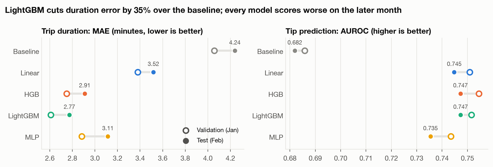
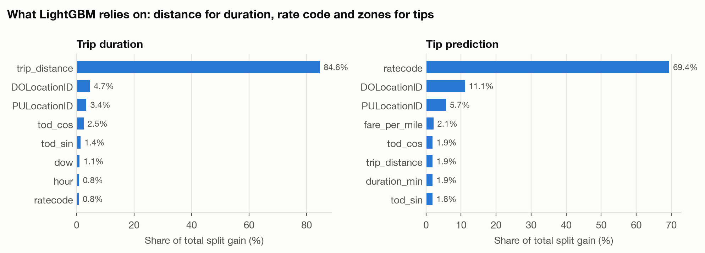
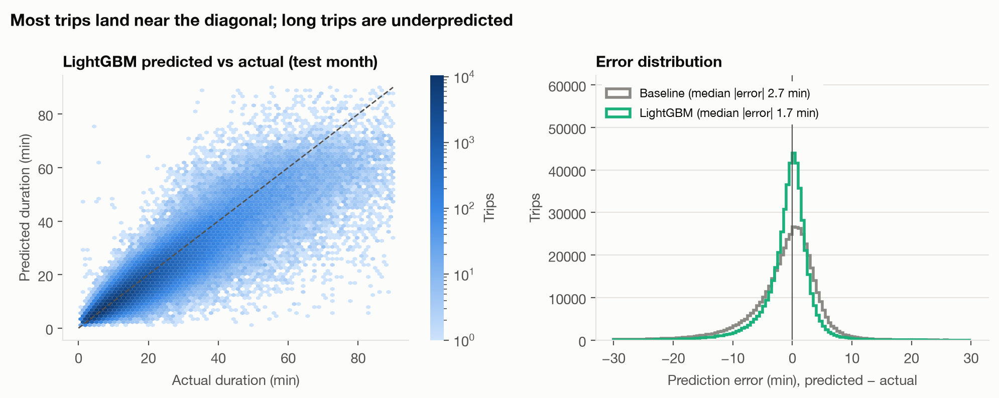
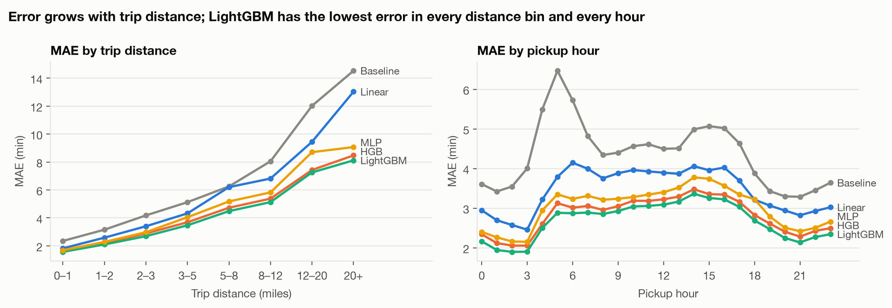
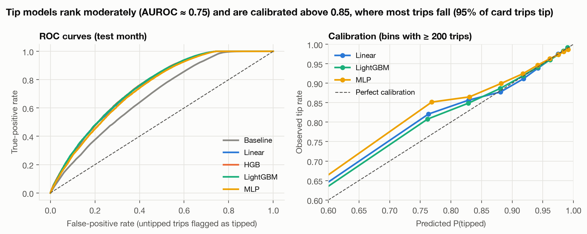

# NYC Taxi: Trip Duration Regression and Tip Classification

Two supervised learning tasks on real NYC TLC yellow taxi records, each solved with
a ladder of models from a simple baseline to gradient boosting and a neural network.

| Task | Type | Target | Main metric |
|------|------|--------|-------------|
| `duration` | Regression | Trip duration in minutes | MAE (minutes) |
| `tip` | Classification | Whether a card-paid trip is tipped | AUROC |

## Questions

1. How much do gradient boosting and a neural network gain over a strong group-median baseline?
2. How well do models trained on one month hold up on the next month (temporal shift)?
3. Which features drive each prediction?

## Models

| Name | What it is |
|------|------------|
| `baseline` | Median duration per route (fallback: pickup zone, then global). Tip rate per pickup zone. |
| `linear` | Ridge / logistic regression on scaled numeric and one-hot categorical features |
| `hgb` | scikit-learn histogram gradient boosting with cross-fitted target encoding for zones and routes |
| `lightgbm` | LightGBM with native categorical zones and early stopping |
| `mlp` | PyTorch MLP with learned embeddings for zones, hour, weekday, rate code, vendor |

## Protocol

- Data: January 2024 for training and validation (90/10 split), February 2024 for testing
- Cleaning: drops trips under 1 minute or over 3 hours, zero or over 100 miles, non-positive fares, zone IDs outside 1–265, and records stamped outside the month
- Duration target is modeled as log1p(minutes) and evaluated in minutes
- Tip task uses card payments only, since cash tips are not recorded
- Leakage checks: the duration task never sees fare or duration; the tip task never sees tip or total amount (enforced in tests)

## Setup and run

```bash
pip install -e ".[dev]"
pytest
bash scripts/download_data.sh
python scripts/run.py --task duration
python scripts/run.py --task tip
```

Override config values from the command line:

```bash
python scripts/run.py --task tip --set models=[hgb,lightgbm] data.n_train=300000
```

On SLURM: `sbatch scripts/slurm_setup.sh` once (environment, data, tests), then `sbatch scripts/slurm_run.sh`. Results go to `runs/<task>/results.json`, test-month predictions to `runs/<task>/test_predictions.parquet`.

Figures: `python scripts/plot_results.py --out figures` (needs the prediction files).

## Results

**Duration (test month, MAE in minutes)**

| Model | Val MAE | Test MAE | R² |
|-------|---------|----------|----|
| baseline | 4.06 | 4.24 | 0.652 |
| linear | 3.38 | 3.52 | 0.766 |
| hgb | 2.75 | 2.91 | 0.832 |
| lightgbm | 2.61 | 2.77 | 0.841 |
| mlp | 2.88 | 3.11 | 0.805 |

**Tip (test month)**

| Model | Val AUROC | Test AUROC | Avg precision |
|-------|-----------|------------|---------------|
| baseline | 0.686 | 0.682 | 0.972 |
| linear | 0.751 | 0.745 | 0.978 |
| hgb | 0.755 | 0.747 | 0.979 |
| lightgbm | 0.752 | 0.747 | 0.978 |
| mlp | 0.744 | 0.735 | 0.977 |

Single run, seed 0. About 95% of card trips are tipped, so average precision mostly reflects the base rate; AUROC is the main tip metric.

### Model ladder and temporal shift



*Figure 1. Hollow markers are validation scores (January), filled markers are test scores (February).*

Gradient boosting gives the largest gain. LightGBM lowers test MAE from 4.24 to 2.77 minutes (−35%) and
raises R² from 0.65 to 0.84. The MLP with learned embeddings lands between linear and boosting (3.11 min),
a common result on tabular data with high-cardinality categories. Every model is worse on the following
month: duration MAE rises by 0.14–0.23 min and tip AUROC falls by 0.004–0.008. Validation within one month
therefore overstates how well a model will do in deployment.

### What the models use



*Figure 2. Share of LightGBM's total split gain for the top eight features.*

Distance accounts for 85% of the gain for duration. Drop-off and pickup zones come next, carrying traffic
and route effects that distance alone misses, followed by time of day. For tips, the **rate code**
dominates (69%). Rate codes separate standard metered trips from airport flat fares and negotiated fares,
which have very different tipping behavior. Drop-off zone comes second.

### Where duration predictions go wrong



*Figure 3. Left: LightGBM predicted against actual duration on the test month (log-density hexbin; dashed line
is perfect prediction). Right: distribution of signed errors.*



*Figure 4. Test MAE by trip distance and by pickup hour.*

- **The median error is 1.7 minutes** for LightGBM, against 2.7 for the baseline. The error distribution
  is much narrower, and its long left tail is underprediction.
- **Long trips are systematically underpredicted.** Mean signed error is about +0.5 min for trips under
  10 minutes, −2.5 min for 20–40 minutes, −5.9 min for 40–60 minutes and −18 min for trips over an hour.
  Those long trips are rare (1% of trips over 60 minutes) and mostly reflect congestion that distance and
  time of day cannot see. Training on log duration also pulls predictions toward the typical trip.
- **Error grows with distance**, from 1.6 min under a mile to 8.1 min over 20 miles, and is lowest
  overnight. For LightGBM it peaks around 2–4 pm (3.4 min). The baseline is worst at 5–6 am (6.5 min),
  when traffic differs most from its route medians. LightGBM has the lowest error in every distance bin and
  every hour.

### Scoring tip predictions



*Figure 5. Left: ROC curves on the test month. Right: calibration, the observed tip rate against the mean
predicted probability within bins.*

All learned models rank far better than the zone-rate baseline, and the four ROC curves nearly coincide, so
model choice matters little for this task. The calibration curves lie on the diagonal above a predicted
probability of 0.85, which covers 98% of LightGBM's test predictions. Expected calibration error is 0.002 for
linear and LightGBM and 0.003 for the MLP. Below 0.85 the models are slightly pessimistic: trips they score
as unlikely to tip still tip more often than predicted. Because 95% of trips are tipped, accuracy (0.96) and
average precision (0.98) are close to their trivial values. AUROC and calibration are the informative scores.

## Limitations

- The duration task uses the recorded trip distance, which a real ETA system would replace with planned route distance.
- One train month and one test month; more months would show whether the shift is seasonal.

## Structure

```
configs/default.yaml      data months, sample sizes, model hyperparameters
src/taxi/data.py          loading and cleaning
src/taxi/features.py      feature engineering and leakage rules
src/taxi/models.py        baseline, linear, HGB, LightGBM behind one interface
src/taxi/mlp.py           PyTorch MLP with embeddings
src/taxi/metrics.py       regression and classification metrics
scripts/run.py            train all models, evaluate on val and next month, save test predictions
scripts/plot_results.py   report figures
figures/                  Figures 1-5
tests/                    cleaning, leakage, and model sanity checks on synthetic data
logs/                     SLURM logs from the reported run (see logs/README.md)
runs/                     results.json for each task (prediction parquet files are git-ignored)
```
